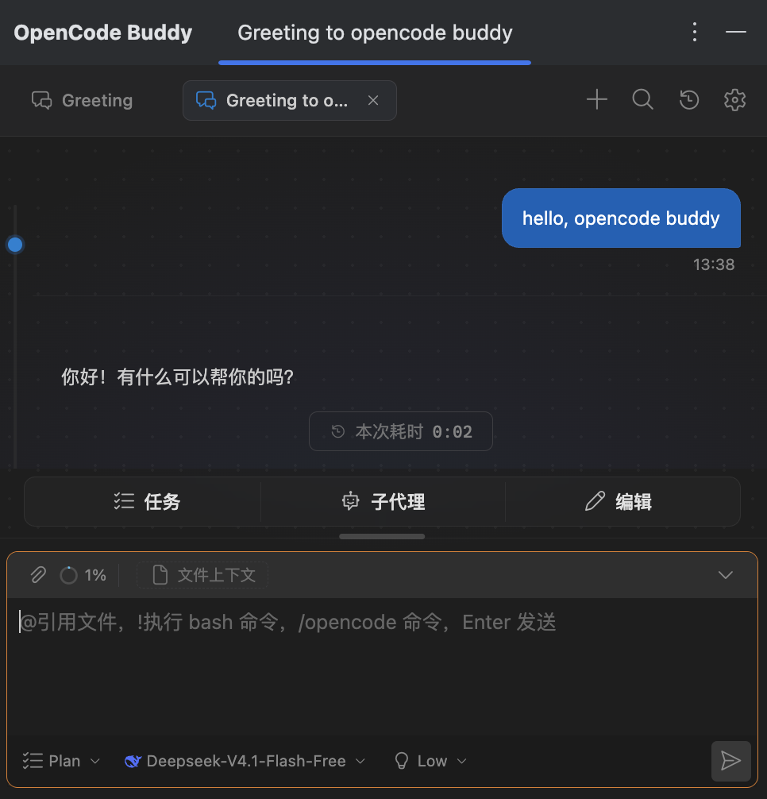
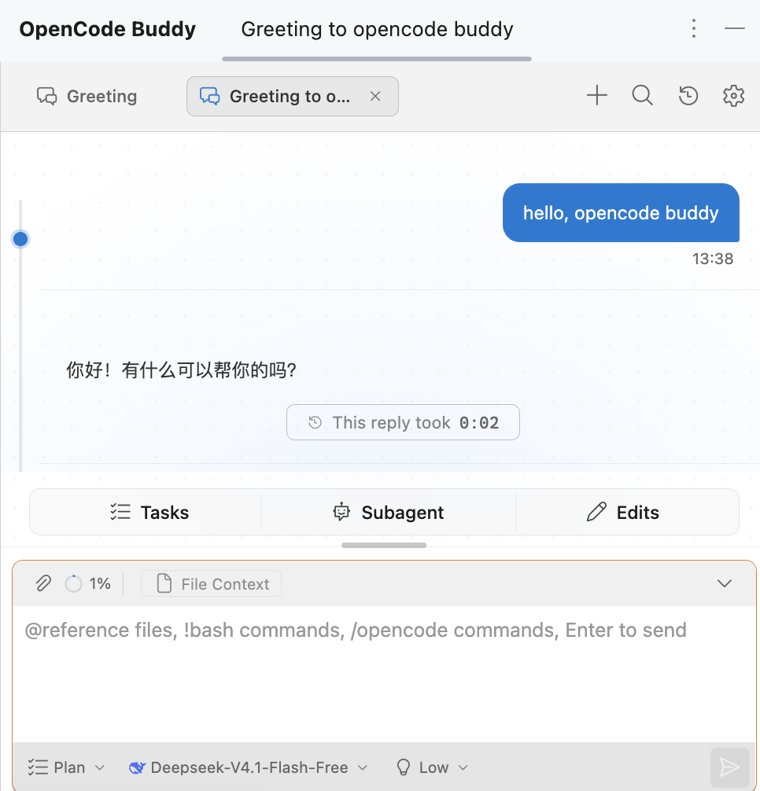
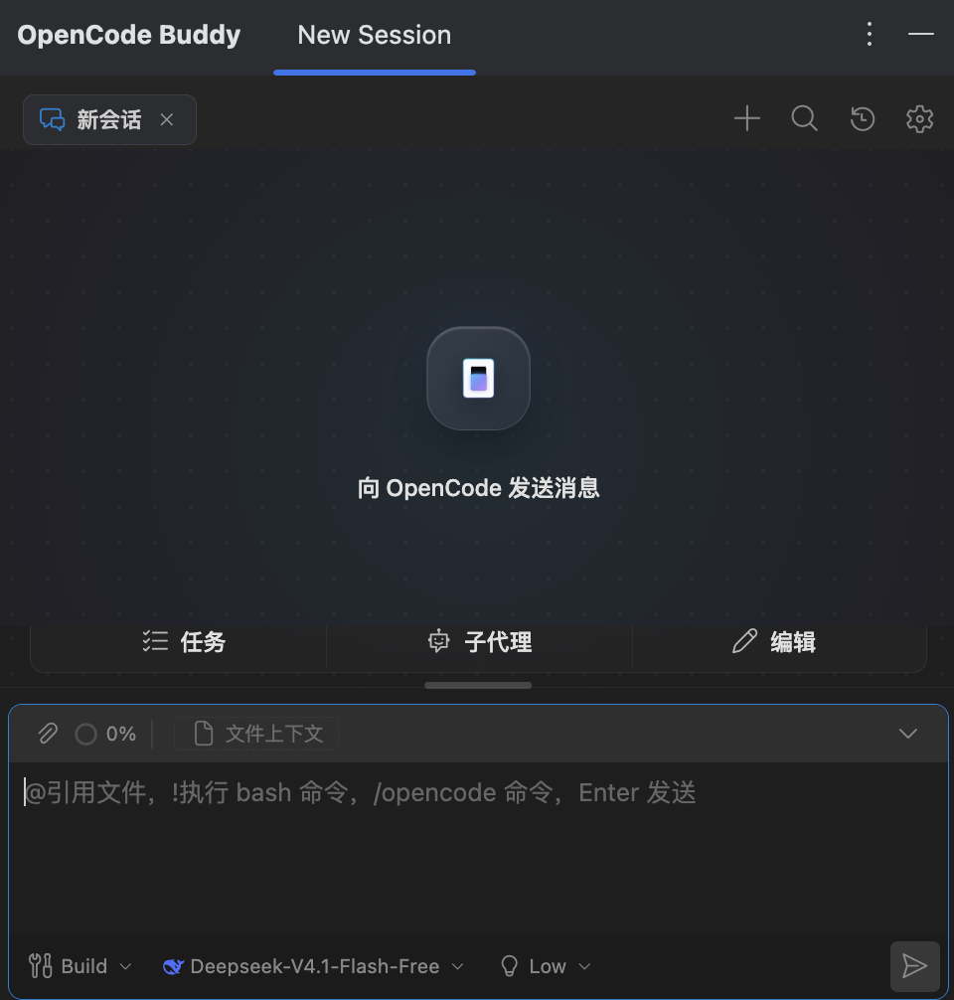
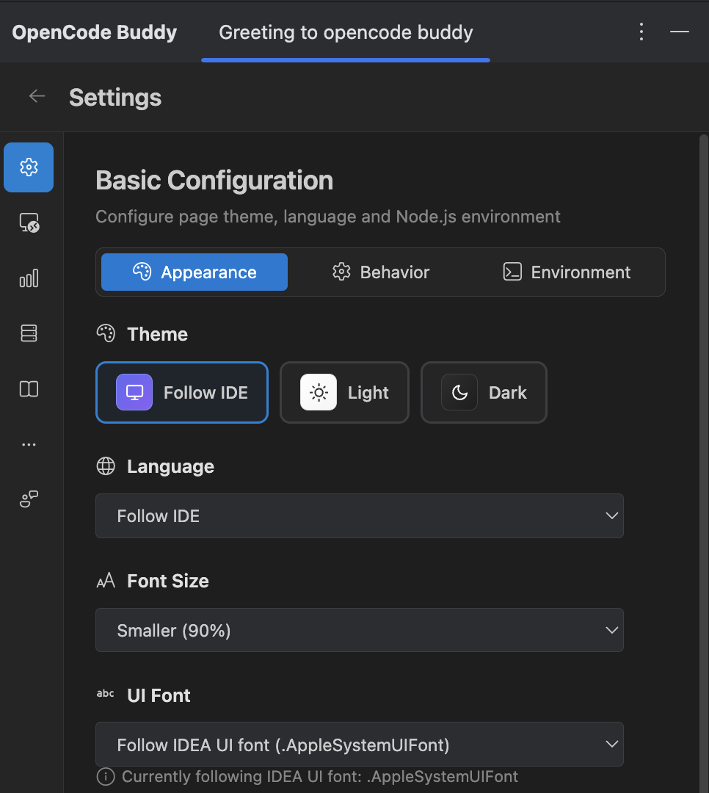

<a id="readme-top"></a>

<div align="center">


# OpenCode Buddy for JetBrains IDEs

<p align="center">
  <strong>专为 IntelliJ IDEA / JetBrains 全家桶打造的 OpenCode 原生全功能可视化 GUI 与工作流助手</strong>
  <br />
  <span>将 OpenCode 编程智能体无缝搬进 JetBrains 工具窗口。</span>
</p>

[](https://plugins.jetbrains.com/)
[](https://opensource.org/licenses/MIT)
[](https://github.com/SenjuObito/opencode-idea-gui/pulls)
[](#-opencode-兼容性)
[](./README.md)

<p align="center">
  <a href="#-关于本项目">关于本项目</a> •
  <a href="#-核心特性">核心特性</a> •
  <a href="#-opencode-兼容性">兼容性</a> •
  <a href="#-快速开始">快速开始</a> •
  <a href="#-使用指南">使用指南</a> •
  <a href="#-架构设计">架构设计</a> •
  <a href="#-开发与构建">开发与构建</a> •
  <a href="#-许可证">许可证</a>
</p>

</div>

---

<details>
  <summary>目录导航</summary>
  <ol>
    <li><a href="#-关于本项目">关于本项目</a></li>
    <li><a href="#-核心特性">核心特性</a></li>
    <li><a href="#-opencode-兼容性">OpenCode 兼容性（v1 与 v2）</a></li>
    <li>
      <a href="#-快速开始">快速开始</a>
      <ul>
        <li><a href="#环境要求">环境要求</a></li>
        <li><a href="#安装">安装</a></li>
      </ul>
    </li>
    <li>
      <a href="#-使用指南">使用指南</a>
      <ul>
        <li><a href="#1-打开聊天窗口">1. 打开聊天窗口</a></li>
        <li><a href="#2-交互矩阵">2. 交互矩阵</a></li>
        <li><a href="#3-设置中心">3. 设置中心</a></li>
      </ul>
    </li>
    <li><a href="#-架构设计">架构设计</a></li>
    <li><a href="#-开发与构建">开发与构建</a></li>
    <li><a href="#-参与贡献">参与贡献</a></li>
    <li><a href="#-许可证与致谢">许可证与致谢</a></li>
  </ol>
</details>

---

## 🌟 关于本项目

<p align="center">
  
  
</p>
<p align="center">
  <em>🌙 深色沉浸模式 &nbsp; | &nbsp; ☀️ 浅色原生模式</em>
</p>

许多 Java / Kotlin / Go / Python 开发者都在 JetBrains IDE 体系下工作。过去想使用 OpenCode，就必须离开
IDE 切到独立终端 —— 割裂感强，而且缺乏针对多文件修改的可视化 Diff 确认。

**OpenCode Buddy (JetBrains)** 把完整的 OpenCode 智能体搬进了原生工具窗口：

- **常驻守护进程桥接** —— 通过 `opencode-buddy-core` 运行时保持 `opencode serve` 进程常驻，具备自动预热、心跳保活与异常自愈重启机制；
- **原生 JCEF 沉浸体验** —— 基于现代 React 19 + JCEF 架构，打造与 IntelliJ 极致契合的界面质感；
- **全流程能力打通** —— 支持多标签会话并行、思考链深度折叠、代码 Diff 逐行审阅、Token 实时消费看板与 MCP 市场扩展。

---

## 🚀 核心特性

* ⚡ **高性能守护进程桥接** —— 集成 `opencode-buddy-core` 运行时，彻底规避按消息频繁起停 CLI 的卡顿，支持连接复用、自动心跳与生命周期自愈。
* 🗂️ **Tab Actor 多会话物理隔离** —— 采用彻底解耦的 Tab Actor 架构，每个标签页独立持有 `TabRecord`、`TabStreamRouter`、`TabMessageStore` 及 Turn 状态机，彻底根治多会话流式串流与状态污染。
* 🔗 **全双工强类型语义契约** —— 前端指令全量收口为单一 `host_command` 类型化信封，宿主事件通过 138 个注册动作的权威语义目录分发，彻底清零脆弱的全局 `window` 位置参数回调。
* 🔌 **OpenCode v1 与 v2 双世代深度兼容** —— 启动智能探测（`v1 | v2 | pending | unknown`），无缝兼容消息流、权限审批、v1 撤销写操作还原与文件快照回滚、压缩总结智能折叠及子代理规范历史对账。
* 💬 **流式会话与思考链可视化** —— 基于 SSE 的极速流式输出、可折叠的思考增量（Thinking Delta）、结构化工具调用卡片与 300 条 LRU HTML 渲染缓存（`MarkdownBlock`）。
* 📎 **分块附件上传与富工程上下文**：
  * 大附件自动切片分块上传，提问仅携带引用 ID，单帧严格控制在 32KB 预算内杜绝 IPC 阻塞；
  * `@` 键智能模糊检索当前工程文件并自动附加；
  * 图片拖拽或剪贴板直接粘贴进入多模态输入；
  * 原生支持 `/init`、`/review`、`/fork`、`/revert` 等斜杠指令及 `!shell` 快捷控制台调用。
* 🛡️ **交互式审批与决策流** —— 工具执行与文件改动的权限审批卡片（一次允许 / 始终允许 / 拒绝）、Agent 提问表单及计划确认，支持 per-tab 队列隔离与 `tabId + sessionId + requestId` 三重校验。
* 📊 **TokenTracker 实时用量看板** —— 实时显示当前轮次 Token 消耗百分比及费用估算，内置多维度使用统计与桥接队列深度、丢弃数、回合耗时等运行指标。
* 🧩 **MCP 市场与 Skills 生态** —— 一键安装、更新与卸载 MCP 服务器，无缝扫描并管理工作区与全局 Skills。
* 🎨 **原生秒开、零白屏闪烁与全息质感** —— 原生 Java2D `AeroLoadingPanel` 纯净秒开与内联深色样式根除白屏闪烁，全新 OpenCode 全息图腾棱晶图标，悬浮微通透毛玻璃胶囊状态面板，自动跟随 IDE 主题与编辑字体。

---

## 🔌 OpenCode 兼容性

OpenCode Buddy **同时支持 OpenCode v1 与 OpenCode v2**，并针对两代协议之间的变更做了充分的兼容设计。

| 能力 | OpenCode v1 | OpenCode v2 |
| :--- | :--- | :--- |
| **通信机制** | `@opencode-ai/sdk` RPC 客户端 | HTTP REST (OpenAPI 3.1) + SSE |
| **版本探测** | `/api/info` 不存在时回退 | `GET /api/info` 返回 HTTP 200 |
| **会话创建** | `{ title, directory }` | `{ title, location: { directory } }` |
| **消息结构** | `role` 字段 | `type` 字段，按时间升序排序 |
| **提问与附件** | `parts` 数组 | `files: [{ uri, name }]` |
| **问题交互** | `question.asked` 事件 | Form 表单体系（`fields` / `field.key`） |
| **权限审批与计划** | `permission.updated` | `permission.asked`，回包使用 `decision` |
| **会话撤销 / 还原** | 写操作自动逆向还原与文件快照回滚 | 快照（Snapshots）回滚工作流 |
| **会话压缩总结** | 压缩总结折叠并保留会话折叠状态 | 压缩折叠状态保留与上下文通告 |
| **子代理权威源** | 子代理 transcript 完整转发 | 规范化 transcript 与 Todo 状态对账 |
| **工具生命周期** | 单一工具事件 | `tool.input.started` → `tool.called` → `tool.success` |

插件如何处理两代差异：

- 启动时守护进程会通过 `GET /api/info` 探测服务端。返回 HTTP 200 即锁定为 **v2** 模式；返回 404 或无响应则回退为 **v1**。
- 请求发送、事件归一化、历史加载、权限/表单回包、快照回退以及工具生命周期处理，全部经过一层版本感知逻辑，因此同一套 UI 可无缝运行在任意一代服务端上。
- 版本状态会以 `pending | v1 | v2 | unknown` 呈现，未确定的服务端绝不会被静默当作 v1 处理。
- 所有决策、提问与计划确认均使用 per-tab 独立队列并带有 `tabId + sessionId + requestId` 三重校验，避免跨会话路由混淆。

> **提示：** 运行 `opencode --version` 可查看本机安装的 CLI 世代，两代均受支持。

---

## ⚡ 快速开始

### 环境要求

1. **JetBrains IDE** —— 版本 **2023.3+**，且支持 JCEF（IntelliJ IDEA、PyCharm、WebStorm、GoLand、Rider 等）。
2. **OpenCode CLI** —— 已安装并可在系统 `PATH` 中运行（通过 `opencode auth login` 配置凭证）。v1 与 v2 均支持。
3. **Node.js** —— 版本 **>= 18.0.0**（内置 `opencode-buddy-core` 守护进程的运行环境）。

### 安装

* **途径 1（JetBrains 插件市场）** —— 在 `Settings → Plugins → Marketplace` 中搜索 `OpenCode Buddy` 并点击 **Install**。
* **途径 2（本地离线安装）** —— 前往 [Releases](https://github.com/SenjuObito/opencode-idea-gui/releases) 下载最新版本的 ZIP 安装包，在插件管理页面选择 `Install Plugin from Disk...`。

---

## 💡 使用指南

### 1. 打开聊天窗口

安装完成后，点击右侧工具栏的 **OpenCode** 图标即可展开工具窗口，或通过 `View → Tool Windows → OpenCode` 唤出。
若本机已有 `opencode serve` 在运行则直接复用，否则插件会自动启动常驻服务。

### 2. 交互矩阵

| 功能模块 | 操作说明 |
|---|---|
| **多标签并发** | 点击顶栏 `+` 开启全新独立会话；右键标签可脱离为浮动窗口 |
| **文件智能引用** | 输入框中键入 `@` 触发文件模糊搜索，方向键选择回车确认 |
| **斜杠指令与终端** | 输入 `/` 调用预设命令，前缀输入 `!` 或 `$` 直接在当前项目上下文执行 Shell |
| **多模态图片** | 截图后直接在输入框按 `Ctrl+V` / `⌘+V`，或直接拖入图片文件 |
| **会话归档与导出** | 顶栏一键导出 Markdown 会话记录，或生成 OpenCode Web 分享链接 |

### 3. 设置中心

点击右上角 ⚙️ 齿轮图标进入设置：

<p align="center">
  
  
</p>
<p align="center">
  <em>🚀 极速纯净新会话 &nbsp; | &nbsp; ⚙️ 全功能偏好与设置中心</em>
</p>

- **外观与行为** —— 自定义字体、主题色彩、发送快捷键（`Enter` 或 `⌘+Enter`）及通知弹窗规则；
- **运行环境** —— 自定义 Node.js 及 `opencode` 可执行文件的探测路径；
- **MCP 与生态** —— 浏览 MCP 工具市场并治理工作区技能。

配置持久化保存在 `~/.opencodebuddy` 目录下。

---

## 🏗️ 架构设计

```
webview/ (React 19 SPA, JCEF)  ⇄  Java 插件宿主 (JBCefJSQuery + Tab Actor 注册表)
                              ⇄  opencode-buddy-core 守护进程 (NDJSON over stdio, 常驻 Node 进程)
                              ⇄  opencode serve (HTTP + SSE, v1 / v2)
```

- **全双工强类型契约**：
  - webview 向宿主发出的所有指令统一走单一 `host_command` 强类型信封（`{requestId, tabId, cmd, payload}`），彻底摒弃位置参数与字符串多重转义的隐患。
  - 宿主向前端推送强类型语义事件信封（`{v, type, tabId, sessionId, turnId, seq, epoch, payload}`），由前端 138 个动作的权威 `hostEventRegistry` 进行查表派发，脆弱的 `window[fn](...args)` 全局回调已完全清零。
- **Tab Actor 物理隔离架构**：
  - 每个会话标签页作为自治的 Tab Actor 运行，独立持有 `TabRecord`、`TabStreamRouter`、`TabMessageStore`（按消息 ID 对账）、专属事件通道及独立 Turn 状态机。
  - 彻底移除全局会话切换锁和跨 Tab 快照浅拷贝。React 视图直接绑定 Tab Store，多标签并行流式输出互不干扰。
- **流式、缓冲与分块传输**：
  - `opencode-buddy-core` 通过 stdio 传输 NDJSON，基于 `AsyncLocalStorage` 实现并发请求上下文隔离。
  - 文件附件采用分块切片上传并在提问中仅传递引用 ID，单帧严格限制在 32KB 预算内杜绝 IPC 阻塞。
  - 会话与配置缓存存放在 `~/.opencodebuddy`；会话消息以 `opencode serve` 为服务端权威源，插件侧维护本地会话索引。

Java 模块布局（`src/main/java/com/opencodebuddy/`）：

```
action/        编辑器、项目视图、控制台、VCS（提交信息）与聊天相关动作
bridge/        Node/opencode 检测、守护进程生命周期、NDJSON 客户端、BridgeScheduler
handler/       强类型宿主命令处理器（设置、provider、会话、权限、历史…）
prompt/        PromptBroker：负责 tab 作用域的权限审批、提问表单与计划确认
session/       会话与消息转换、revert / fork / 压缩、TabRecord 与 TabStreamRouter
provider/      opencode provider 接线与模型目录
mcp/ skill/    MCP 服务器、技能
ui/            工具窗口、标签页、脱离窗口、AeroLoadingPanel、JCEF 初始化
notifications/ 状态栏小组件与气泡通知
settings/      插件设置持久化（~/.opencodebuddy）
util/ utils/   字体、i18n、token 用量、平台辅助
```

---

## 🛠️ 开发与构建

仓库包含三个部分，各有独立依赖：

| 部分 | 作用 | 安装 | 构建 |
|---|---|---|---|
| `src/main/java/` | JetBrains 插件宿主（JCEF 桥、handlers、actions、工具窗口） | — | `./gradlew compileJava` |
| `webview/` | React 19 + Vite + Tailwind CSS + antd 聊天 UI | `cd webview && npm ci` | `cd webview && npm run build` |
| `opencode-buddy-core/` | 常驻守护进程：`opencode serve` + HTTP/SSE（打包为 `ai-bridge.zip`） | 由 Gradle 自动拉取/构建 | 见 [opencode-buddy-core](https://github.com/SenjuObito/opencode-buddy-core) |

当 `node_modules` 缺失时，Gradle 构建会自动执行 npm 安装，因此从干净检出直接 `./gradlew buildPlugin` 即可。

```bash
# 1. 克隆代码仓库
git clone https://github.com/SenjuObito/opencode-idea-gui.git
cd opencode-idea-gui

# 2. 编译 Webview 前端
cd webview && npm ci && npm run build && cd ..

# 3. 运行本地开发沙箱调试
./gradlew runIde

# 4. 构建打包分发插件包
./gradlew buildPlugin
# 产物输出在 build/distributions/
```

### 命令（Gradle）

| 任务 | 命令 |
|---|---|
| 在沙箱 IDE 中运行插件 | `./gradlew runIde` |
| 打包发布 zip | `./gradlew buildPlugin`（产物在 `build/distributions/`） |
| Java 单元测试 | `./gradlew test` |
| 对真实 IDE 构建做兼容性校验 | `./gradlew verifyPlugin` |
| 重新生成 `plugin.xml` | `./gradlew patchPluginXml` |
| 跳过 webview 构建 | 追加 `-PskipWebview=true` |
| 构建到其它 IDE（PyCharm / Rider） | 追加 `-PtargetIde=PC`、`-PtargetIde=PY` 或 `-PtargetIde=RD` |

### 命令（webview）

| 任务 | 命令 |
|---|---|
| 构建 | `cd webview && npm run build`（tsc → vite build，单文件 bundle） |
| 单元测试 | `cd webview && npm test`（vitest） |
| E2E 测试 | `cd webview && npm run test:e2e`（Playwright） |
| 仅类型检查 | `cd webview && npx tsc --noEmit` |

> 构建插件需要 JDK 21 工具链（`sourceCompatibility` / `targetCompatibility` = 17）。

---

## 🤝 参与贡献

Contributions are what make the open source community such an amazing place to learn, inspire, and create.

1. Fork 本仓库
2. 创建特性分支（`git checkout -b feature/AmazingFeature`）
3. 提交改动（`git commit -m 'feat: Add some AmazingFeature'`）
4. 推送分支（`git push origin feature/AmazingFeature`）
5. 发起 Pull Request

---

## 📄 许可证与致谢

- **许可证** —— 基于 **MIT License** 开源。详情参见 [`LICENSE`](./LICENSE)。
- **特别致谢** —— 感谢上游项目 [`jetbrains-cc-gui`](https://github.com/zhukunpenglinyutong/jetbrains-cc-gui) 的启发与卓越实践，以及同源的 VS Code 版本 [`opencode-vscode-plugin`](https://github.com/SenjuObito/opencode-vscode-plugin)。

如果这个项目对你有帮助，欢迎 [赞助支持 →](SPONSORS.md)。

<p align="right">(<a href="#readme-top">back to top ↑</a>)</p>
