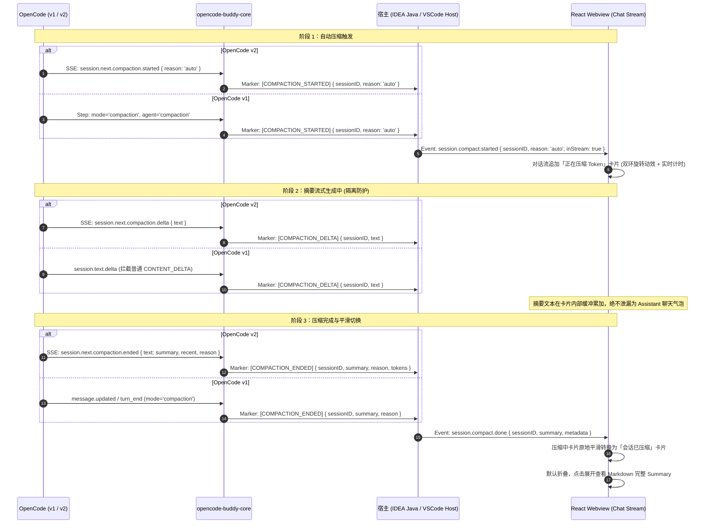

# OpenCode 自动压缩 Token（Auto-Compaction）流式监听与卡片折叠交互设计文档

本文档系统阐述了在 **OpenCode IDEA GUI** 与 **OpenCode VS Code Plugin** 双端插件中，针对 **OpenCode 自动压缩上下文 Token（Auto-Compaction）** 的完整技术方案与架构实现，涵盖 Node.js AI-Bridge Daemon 层、IntelliJ IDEA Java 宿主层、VS Code 扩展宿主层以及 React Webview 对话流的端到端适配。

---

## 1. 背景与问题定义

OpenCode 在对话上下文接近或超出模型最大上下文窗口（Context Window）时，会触发自动上下文压缩（Auto-Compaction / Token Compression）并生成历史对话摘要（Summary）。

### 1.1 现状缺陷（Root Causes）
1. **OpenCode v2 根因**：
   - OpenCode v2 在上下文超限时通过 SSE 推送 `session.next.compaction.started`、`session.next.compaction.delta` 和 `session.next.compaction.ended`。
   - `opencode-buddy-core` 的 `opencode-daemon-service.js`（1575 行）在收到 `started` 和 `delta` 时仅做 `logDebug`，未向宿主发射 Marker；`ended` 仅触发了无摘要文本的 `[SESSION_COMPACT_RESULT]`。
2. **OpenCode v1 根因**：
   - OpenCode v1 的自动压缩是以 `mode: 'compaction'` 的虚拟助手 turn 运行，其生成的摘要文本作为普通的 `session.text.delta` 发送。
   - 核心层将其作为普通 `[CONTENT_DELTA]` 发送，Webview 的流式渲染器没有感知到此 turn 的 compaction 特征，直接创建了普通的 assistant 气泡并将摘要打字渲染出来。
3. **宿主与 Webview 根因**：
   - 宿主 `OpenCodeMessageHandler.java` 与 VS Code `MarkerParser.ts` 收到 `[SESSION_COMPACT_RESULT]` 后仅打印了 log，未将其转换为 Webview 语义事件。
   - Webview 现有的 `CompactSummaryBlock`（折叠卡片）只在满足 `type === 'user' && raw.isCompactSummary` 时生效，流式助手消息直接穿透到了普通 Markdown 气泡。
   - **用户体感**：用户正在等待回答时，聊天界面突然以助手气泡形式突兀地开始打字输出长篇 Summary，不仅破坏了对话体验，且无法进行结构化折叠查看。

### 1.2 预期目标
1. **实时监听**：精准捕获 OpenCode v1 与 v2 的自动压缩事件。
2. **在途感知（压缩中）**：在对话流中展示具有加载动效与计时器的「正在压缩 Token」紧凑卡片，拦截并缓冲流式摘要文本，绝不泄漏至普通助手对话气泡。
3. **完成呈现（压缩成功）**：压缩完成后，原地平滑切换为「会话已压缩」成功卡片，展示压缩统计（Token 节约率、耗时等）。
4. **可折叠展开**：默认折叠保持界面整洁，用户点击卡片可平滑展开查看 Markdown 格式的完整 Summary。
5. **双端与双世代兼容**：
   - 同时兼容 OpenCode v1 和 OpenCode v2；
   - 兼容 IntelliJ IDEA 插件与 VS Code 插件。

---

## 2. 整体时序与数据流架构



---

## 3. v1 与 v2 双世代版本兼容策略

| 阶段 / 特性 | OpenCode v1 兼容方案 | OpenCode v2 兼容方案 |
| :--- | :--- | :--- |
| **触发识别** | 监听 step/message 中的 `mode === 'compaction'` 或 `parts: [{ type: 'compaction' }]` | 监听 SSE 事件 `session.next.compaction.started` / `session.compaction.started` |
| **流式摘要** | 拦截 `session.text.delta`，**阻断发往 `[CONTENT_DELTA]`**，重定向发送 `[COMPACTION_DELTA]` | 监听 `session.next.compaction.delta`，发送 `[COMPACTION_DELTA]` |
| **结束识别** | 监听 assistant 消息结束且属性为 `summary: true`，提取完整 summary | 监听 `session.next.compaction.ended`，提取 `props.text` 与 tokens 统计 |
| **历史回溯** | `OpenCodeMessageConverter` 识别 `mode === 'compaction'`，封装为 `isCompactSummary = true` | 识别 `m.type === 'compaction'` 或 `role === 'compaction'`，封装为 `isCompactSummary = true` |

---

## 4. 分层改造实施方案

### 4.1 核心层（`opencode-buddy-core`）
**文件**：`services/opencode/opencode-daemon-service.js`

1. **输出统一 Compaction 协议 Marker**：
   - 收到 `session.next.compaction.started` / `session.compaction.started` 时：
     ```javascript
     emitJsonStringMarker('[COMPACTION_STARTED]', {
       sessionID: compactSessionID,
       messageID: props?.messageID || props?.data?.messageID || '',
       reason: props?.reason || 'auto',
     });
     ```
   - 收到 `session.next.compaction.delta` / `session.compaction.delta` 时：
     ```javascript
     emitJsonStringMarker('[COMPACTION_DELTA]', {
       sessionID: compactSessionID,
       text: props?.text || props?.delta || '',
     });
     ```
   - 收到 `session.next.compaction.ended` / `session.compaction.ended` 时：
     ```javascript
     resolvePendingCompaction(compactSessionID, true);
     emitJsonStringMarker('[COMPACTION_ENDED]', {
       sessionID: compactSessionID,
       summary: props?.text || '',
       reason: props?.reason || 'auto',
       tokens: props?.tokens,
       recent: props?.recent,
     });
     ```
2. **OpenCode v1 流式隔离门禁**：
   - 在 `_handlePartDelta` 及 `session.text.delta` 分发前，判断当前 turn 是否为 `mode === 'compaction'`。
   - 若是 compaction turn，禁止调用 `emitJsonStringMarker('[CONTENT_DELTA]', delta)`，改发 `[COMPACTION_DELTA]`，彻底阻断摘要泄漏至普通气泡。

---

### 4.2 宿主层（IDEA 插件 + VSCode 插件双端对齐）

#### A. IDEA Java 宿主
**文件**：
- `src/main/java/com/opencodebuddy/provider/opencode/OpenCodeMarkerParser.java`
- `src/main/java/com/opencodebuddy/session/OpenCodeMessageHandler.java`
- `src/main/java/com/opencodebuddy/bridge/EventCatalog.java`

1. `OpenCodeMarkerParser` 解析 `[COMPACTION_STARTED]`、`[COMPACTION_DELTA]`、`[COMPACTION_ENDED]` 并分发到 `MessageCallback`。
2. `OpenCodeMessageHandler` 收到对应回调后：
   - `compaction_started` → 发送语义事件 `session.compact.started`，携带 `{ sessionId, reason: "auto", inStream: true }`；
   - `compaction_delta` → 发送语义事件 `session.compact.delta`，携带 `{ sessionId, text }`；
   - `compaction_ended` → 发送语义事件 `session.compact.done`，携带 `{ sessionId, summary, reason, tokens }`。
3. `EventCatalog.java` 注册映射关系以保证桥调用正确派发至 Webview。

#### B. VSCode TypeScript 宿主
**文件**：
- `src/host/session/MarkerParser.ts`
- `src/host/window/ChatWindow.ts` / `WindowEventHandler.ts`
- `src/host/router/EventCatalog.ts`

- 在 `MarkerParser.ts` 中同步实现上述 3 个 Marker 解析，通过 `publishRecordEvent` 分发 `session.compact.started` / `session.compact.done` 至 Webview，与 IDEA 侧保持 100% 协议一致。

---

### 4.3 前端 Webview 层（React 共享代码）
**文件**：
- `webview/src/types/index.ts`
- `webview/src/hooks/useMessageProcessing.ts`
- `webview/src/components/MessageItem/ContentBlockRenderer.tsx`
- `webview/src/components/CompactingIndicator.tsx`
- `webview/src/App.tsx`

1. **类型扩展**：
   - `ClaudeMessage.raw` 扩展 `compactStatus: 'in_progress' | 'success' | 'failure'`、`isCompacting?: boolean`。
   - 统一 `compact_summary` 与 `compact_progress` 卡片数据结构。
2. **对话流状态机生命周期**：
   - **压缩开始（`onCompactStarted`）**：
     若 `inStream: true`（自动压缩），在当前 session 的 `messages` 末尾插入一条合成系统消息：
     ```typescript
     {
       id: `compact_${Date.now()}`,
       type: 'notification',
       content: '',
       raw: {
         isCompactSummary: true,
         compactStatus: 'in_progress',
         trigger: reason || 'auto',
         startTime: Date.now()
       }
     }
     ```
   - **流式累加（`onCompactDelta`）**：
     在内存中缓冲该摘要文本，不向消息正文追加 Markdown。
   - **压缩完成（`onCompactSuccess`）**：
     查找到 `compactStatus === 'in_progress'` 的卡片消息，原地更新为：
     ```typescript
     {
       ...compactMsg,
       content: summaryText,
       raw: {
         ...compactMsg.raw,
         compactStatus: 'success',
         compactMetadata: {
           trigger: reason,
           preTokens, postTokens, durationMs
         }
       }
     }
     ```
3. **UI 卡片组件渲染（`ContentBlockRenderer.tsx`）**：
   - **在途压缩卡片（In-Progress）**：
     - 单行紧凑设计（行高 28~32px）；
     - 左侧图标：顺时针旋转双环动效或 `codicon-loading codicon-modifier-spin`；
     - 提示文本：`正在自动压缩上下文 Token...`；
     - 右侧徽章：微拟物动态等宽计时（如 `00:04`）。
   - **压缩完成卡片（Success - Collapsible）**：
     - 左侧图标：翠绿色 `codicon-check` + `已自动压缩上下文` + 统计信息（如 `· 128.5K → 12.3K · 4s`）；
     - 右侧指示：`codicon-chevron-right` / `codicon-chevron-down`；
     - **交互动作**：整行点击切换展开状态；展开区域调用 `MarkdownBlock` 渲染完整的 summary 文本，再次点击优雅收起。
4. **消息预处理与去重（`useMessageProcessing.ts`）**：
   - 过滤与转换规则放行 `compactStatus === 'in_progress'` 与 `isCompactSummary === true` 消息；
   - 历史消息加载时，无论 v1 还是 v2 格式，统一折叠呈现，严禁历史摘要文本裸露。

---

## 5. 质量保障与单测规划

1. **`opencode-buddy-core` 单测**：
   - 验证 v2 `session.next.compaction.started/delta/ended` 发射规范的 `[COMPACTION_*]` 标记线；
   - 验证 v1 compaction turn 的 `CONTENT_DELTA` 被隔离，不混入普通 assistant 输出。
2. **IDEA & VSCode 宿主单测**：
   - 验证 `MarkerParser` 能够正确解析 markers 并分发对应的语义事件；
   - 验证多 Tab/多会话并发下，compaction 事件精准路由到对应 `sessionId`。
3. **Webview 组件与 Hook 单测**：
   - 验证在途状态卡片（旋转动效 + 计时）正确渲染；
   - 验证成功后卡片原地平滑转换为折叠卡片；
   - 验证卡片点击展开与收起 Markdown 摘要。
