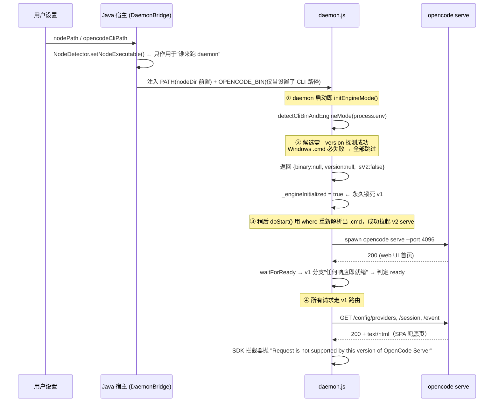

# opencode CLI 解析 & 引擎模式（v1/v2）确定 —— 架构与完整方案

> 覆盖范围：`opencode-idea-gui`（Java 宿主）、`opencode-buddy-core`（Node 守护进程 ai-bridge）。
> 目标：**用户设置优先 → 扫描 → 验证 → 锁定**，同时兼容 opencode v1 / v2，兼容 Windows / Linux / macOS。
> 本文只描述设计与落地清单，不含已实施的代码改动。

---

## 0. 结论先行

当前实现有两个结构性错误：

1. **优先级漏了第一级**：用户设置里的 `nodePath` / `opencodeCliPath` 在 Java 侧生效，但传到守护进程时
   **被降级成"改 PATH"**，守护进程根本不知道"这是用户指定的路径"，只能重新扫描。
2. **"锁定"的时机和判据都错**：`daemon.js` 在**进程启动瞬间**就用裸 `process.env` 判一次并锁死
   （`04a79b8` 引入），此时既没解析到真实 binary，探测本身在 Windows 上也必然失败，
   于是把"探测不到"当成了 **v1**，造成 v2 服务端上跑 v1 路由。

正确的模型应是三层：**解析（resolve）→ 验证（verify）→ 锁定（lock）**，
且**只有验证通过才允许锁定**，验证不了就是 `unknown`，绝不能静默降级为 v1。

---

## 1. 现状梳理（真实链路 + 缺陷）

### 1.1 当前真实时序



### 1.2 缺陷清单

| # | 位置 | 问题 | 后果 |
|---|------|------|------|
| D1 | `daemon.js:584` | 在进程启动瞬间调用 `initEngineMode()` 并永久锁定 | 锁定发生在 binary 解析**之前**，锁定值无意义 |
| D2 | `utils/cli-path.js:300` `probeCliVersion()` | `execFileSync(bin,['--version'])` 无 `shell` | Windows npm 的 `.cmd` 抛 `EINVAL`，版本探测**恒为 null** |
| D3 | `utils/cli-path.js:354-364` | `if (!ver) continue` | 任何候选只要探测失败就被丢弃 → 全部候选阵亡 |
| D4 | `utils/cli-path.js:351,366-388` | 全部失败后返回 `isV2:false` | **把"未知"当成 v1**，是本次故障的放大器 |
| D5 | `utils/cli-path.js:331-335` | 候选读 `process.env`，而 `env` 参数只用于探测 | 传入的 `probeEnv`（已 enrich PATH）形同虚设；`whichOnPath` 也固化用 `process.env` |
| D6 | `serve-manager.js:349-351` | `if (!_engineInitialized) initEngineMode(spawnEnv)` | 已锁死就永不重算，后续 `where` 解析成功也救不回来 |
| D7 | `serve-manager.js:265-275` | `waitForReady` v1 分支"任何 HTTP 响应即就绪" | v1/v2 不匹配被静默掩盖，UI 显示正常 |
| D8 | `serve-manager.js:166-171` | `isV2()` 是不可恢复的进程级常量 | 用户改设置 / 换 opencode 版本必须整进程重启才可能生效 |
| D9 | `serve-manager.js:33-34` | 密码在模块加载时从 `process.env` 读取并缓存 | 与"启动时确定"耦合，动态配置无法生效 |
| D10 | `DaemonBridge.java:364-368` | 只注入 `OPENCODE_BIN`；node 路径靠改 PATH | 用户设置的语义丢失，daemon 无法区分"用户指定"与"扫描得到" |
| D11 | `EnvironmentConfigurator.java:93-104` | 在 PATH 末尾追加 `%APPDATA%\npm` | 能"找到"但找不到对的形态（`.cmd` vs `.exe`），放大 D2 |
| D12 | Java `CliStatusDetector.candidatesFor()` vs Node `cli-path.js` | **两套各自独立的候选顺序与语义** | Java 设置页显示"已安装"、daemon 却用不了（或反之），无法对账 |

---

## 2. 设计原则

1. **单一权威解析器**：候选来源、顺序、验证规则只有一份定义（Node 侧 `cli-path.js` 为权威实现），
   Java 侧只做"**注入用户设置 + 展示状态**"，不再自己维护一套候选逻辑。
2. **用户设置是第一优先级**：`nodePath` / `opencodeCliPath` 由宿主解析成**绝对路径**并显式注入，
   守护进程不得再"猜"。
3. **验证通过才锁定**：锁定值必须来自一次成功的 `--version` 探测或一次成功的服务端能力探测，
   否则状态是 `unknown`，并且**不允许** `unknown → v1` 的隐式转换。
4. **引擎模式以"能力探测"为准，不以版本号为准**：版本号字符串只用于日志与展示；
   判定用 HTTP 能力（`/api/info` 200 ⇒ v2）。这样 future v3 不会重演同类事故。
5. **失败必须可见**：解析/探测失败要沿 daemon → 宿主 → 前端状态栏一路上报，不允许静默兜底。
6. **平台差异收敛在一处**：`Windows .cmd/.bat 需要 shell`、`WSL 路径需要 wsl 前置`、
   `macOS GUI 需要 login+interactive shell 兜底`，全部在解析器内部处理，调用方无感。

---

## 3. 目标架构（摘要）

> 完整架构设计见 **`docs/engine-resolution-architecture.md`**：模块边界与契约、接口 IDL、
> 状态机形式定义（含迁移表与不变量）、依赖规则与禁止清单、并发模型、扩展点、ADR、测试 seam。
> 本节只保留结论性摘要，细节不在此重复。

### 3.1 分层职责

| 层 | 组件 | 职责 | 不做 |
|----|------|------|------|
| 设置层 | 前端 `EnvironmentTab` + `OpenCodeBuddySettingsService` | 读写 `nodePath` / `opencodeCliPath`；保存后触发 daemon 重启 | 不参与候选扫描 |
| 宿主层 | `DaemonBridge` + `EnvironmentConfigurator` | 把用户设置解析成绝对路径并注入 `NODE_BIN` / `OPENCODE_BIN`；注入配置目录；上报引擎状态给 UI | 不判定引擎版本 |
| 桥接层 | `cli-path.js`（权威解析器）<br>`engine-probe.js`（能力探测，新增） | 按 L0→L4 解析并验证 binary；探测服务端能力 | 不做路由分叉 |
| 路由层 | `opencode-serve-manager.js` + `opencode-sdk-client.js` | 持有已锁定的引擎状态；按状态走 v1/v2 路由 | 不猜模式，不静默降级 |

### 3.2 状态机（三态，可恢复）

```
        resolve+verify 成功(v2)                settings 变更 / daemon 重启
unknown ─────────────────────────► v2 ──────────────────────► unknown
   │                                                            ▲
   └──── resolve+verify 成功(v1) ──► v1 ─────────────────────────┘
   │
   └──── resolve/verify 全失败 ──► unknown + reason（上报 UI，阻断式报错）
```

* `unknown` 是**一等状态**，不是 `false`。`isV2()` 的三态 API：`getEngineState(): 'v1'|'v2'|'unknown'`。
* 锁定的生命周期 = **一次 daemon 进程**。用户改设置 → 宿主重启 daemon → 重新解析锁定。
* 首次请求若发现 `unknown`，允许**一次性懒探测**（打一次服务端能力探测），避免用户必须重启。

---

## 4. 完整流程（目标形态）

### 阶段 0：设置 → 宿主解析（Java）

1. 读 `~/.opencodebuddy/config.json` 的 `nodePath` / `opencodeCliPath`。
2. 若设置了：解析为绝对路径 → **验证**（文件存在 + 可执行 + `<path> --version` 返回 0）。
   * 验证失败：**不静默回退**，前端错误面板明确提示"你配置的路径无效"，并给出"改用自动检测"按钮。
3. 注入 daemon 环境（**实际落地契约**，见 `CliSpecResolver` / `EnvironmentConfigurator`）：
   | 变量 | 值 | 说明 |
   |------|-----|------|
   | `OPENCODEBUDDY_CLI_PATH` | 用户配置的 opencode 绝对路径 | **权威 L0**：由 `~` / `%VAR%` / `$VAR` / 相对路径展开而来；只有用户配置过才注入，未配置则**不注入**（"宿主没有意见" 与 "宿主说就是这个路径" 必须可区分） |
   | `OPENCODEBUDDY_NODE_BIN` | 宿主实际使用的 node 路径 | 仅在路径为绝对形式时注入；`NodeDetector` 的 `"node"` 兜底值**不得**注入（裸名会被 L0 当作"配置了但不存在"从而阻断引擎） |
   | `OPENCODEBUDDY_CONFIG_DIR` | `~/.opencodebuddy` | 宿主与两个 bridge 进程共享的状态目录（如自动生成的 serve 口令） |

   > 变量名与 `OPENCODE_BIN` 分离是刻意的：`OPENCODE_BIN` 是**尽力而为**的 L1（与用户 shell 环境同namespace），
   > 复用它会让"设置配错"退化成"静默用了另一个版本"，且丢失来源可归因性。见 `engine-resolution-architecture.md` §ADR-4。
   >
   > 宿主**不做**存在性校验：daemon 可能与 IDE 处于不同文件系统命名空间（WSL），而 L0 校验失败是阻断式的。
4. 保存设置后必须重启 daemon（现有重启入口），否则注入不生效。

### 阶段 1：守护进程解析（Node，权威）

`resolveCli({ kind: 'opencode' | 'node', env })` 按顺序取候选，**逐个验证，第一个通过的即采纳**：

```
L0 用户设置      NODE_BIN / OPENCODE_BIN（宿主注入）        ← 命中即用，不再扫描
L1 显式环境变量  OPENCODE_PATH / OPENCODE_CLI_PATH / NODE_BIN
L2 已知安装位置  平台矩阵（见 §6）
L3 PATH 查找     where.exe(Windows) / which(macOS,Linux)
L4 裸命令名      最后兜底（仅当 L3 也失败）
```

* **验证规则（统一）**：
  1. 绝对路径 → 存在性检查；`node` 类必须 basename 为 `node`/`node.exe`；
  2. `Windows` 下 `.cmd/.bat` → **必须 `shell: true`** 执行，或等价地 `cmd.exe /c <bin> --version`；
  3. 解析 stdout/stderr 的第一个版本号 token，拿不到版本号则视为**验证失败**（不是"unknown 也算过"）；
  4. 全部候选失败 → 返回 `{ resolved: null, reason }`。
* 解析结果与原因写入日志并推给宿主。

### 阶段 2：启动服务 + 能力探测

1. `spawn <opencode> serve --port <port>`（v1/v2 参数一致）。
2. 就用**启动后的真实服务**做能力探测，而不是去看 CLI 版本号：
   * `GET /api/info` → 200 ⇒ **v2**
   * 否则 `GET /config` → `application/json` ⇒ **v1**
   * 两者都不通 ⇒ `unknown`（启动失败，按现有 auto-restart 退避重试；到上限后上报）
3. 探测成功 → **此时才锁定**；探测失败 → 保持 `unknown`，**不再默认 v1**。
4. `waitForReady()` 改为按探测结果校验（v2 必须 `/api/info` 200；v1 必须 `/config` 返回 JSON），
   不允许"任何响应即就绪"。

### 阶段 3：路由

* `serveManager.getEngineState()` 是唯一真值来源；`opencode-sdk-client.js` 的二十余处分叉
  改为读该状态。
* `unknown` 时：**先 `await ensureEngine()`**（一次性懒探测），仍失败则抛出可读错误
  "未能确定 opencode 引擎模式（v1/v2），请检查 CLI 安装" —— 而不是发一个注定返回 HTML 的请求。

### 阶段 4：上报与可观测

* daemon → 宿主事件：`engine_mode { state, cliVersion, binary, source: 'settings'|'env'|'scan'|'path'|'fallback', reason }`
* 宿主 → 前端：设置页"环境"分区展示 `opencode 路径 / 版本 / 引擎模式 / 来源`；
  `unknown` 时状态栏显示带重试按钮的警告条（沿用现有 `StatusNoticeBar`）。
* 日志：把"未解析到 binary""探测失败"从 INFO 提升为 WARN。

---

## 5. 优先级决策表

| 优先级 | 来源 | opencode | node | 命中即止 | 验证失败时 |
|--------|------|----------|------|----------|------------|
| L0 | 用户设置（宿主注入 `OPENCODE_BIN` / `NODE_BIN`） | ✅ | ✅ | 是 | **报错阻断**，不回退 |
| L1 | 显式环境变量 | `OPENCODE_PATH`、`OPENCODE_CLI_PATH` | `NODE_BIN` | 是 | 继续下一候选 |
| L2 | 已知安装位置（§6） | ✅ | ✅ | 是 | 继续下一候选 |
| L3 | PATH（`where` / `which`） | ✅ | ✅ | 是 | 继续下一候选 |
| L4 | 裸命令名 | `opencode` | `node` | 是 | 返回 `unknown` |

> 冲突处理：L0 由宿主注入，若磁盘上也存在同名环境变量，**宿主注入值覆盖之**（即用户设置胜出）。

---

## 6. 跨平台矩阵

| 平台 | opencode 候选（L2） | node 候选（L2） | 特殊处理 |
|------|--------------------|----------------|----------|
| **Windows** | `%APPDATA%\npm\opencode.{exe,cmd,bat}`、`%LOCALAPPDATA%\pnpm\opencode.*`、`%USERPROFILE%\scoop\shims\opencode.*`、`~/.opencode/bin/opencode.*`、`~/.local/share/opencode/bin/opencode.*` | `C:\Program Files\nodejs\node.exe`、ProgramData\chocolatey、scoop、`%APPDATA%\nvm\current`、`%APPDATA%\nvm\v*`、fnm、volta、`%LOCALAPPDATA%\Programs\nodejs` | **`.exe` > `.cmd` > `.bat` > 无扩展名**；`.cmd/.bat` 必须 `shell:true`；`where` 输出需挑可 spawn 形态 |
| **macOS** | `/opt/homebrew/bin/opencode`(ARM)、`/usr/local/bin/opencode`(Intel)、`~/.opencode/bin/opencode`、`~/.local/bin/opencode`、`~/.local/share/opencode/bin/opencode` | `/opt/homebrew/opt/node@*/bin/node`、`/usr/local/opt/node@*/bin/node`、`~/.nvm/versions/node/*/bin/node`、`~/.volta/bin/node`、`~/.fnm/aliases/default/bin/node`、`~/.nvmd/bin/node` | GUI 启动（Finder）无 login shell → 用 `$SHELL -l -i -c 'which …'` 兜底（已有 `resolveLoginShell` 白名单机制） |
| **Linux** | `~/.opencode/bin/opencode`、`~/.local/bin/opencode`、`~/.local/share/opencode/bin/opencode`、`/usr/local/bin/opencode`、`/usr/bin/opencode` | `/usr/bin/node`、`/usr/local/bin/node`、`~/.nvm/versions/node/*/bin/node`、`~/.volta/bin/node`、`~/.fnm/aliases/default/bin/node` | 无 `where`，用 `which`；PATH 极简（IDE 由 desktop 启动）时需补 `~/.local/bin` |
| **WSL（Windows 宿主 + Linux node）** | 同 Linux，路径以 `/` 开头 | 同 Linux | 探测必须 `wsl <path> --version`；`EnvironmentConfigurator` 需把 `NODE_BIN`/`OPENCODE_BIN` 转成 WSL 形态并加入 `WSLENV` |

---

## 7. v1 / v2 兼容策略

* **不改路由实现**：`opencode-sdk-client.js` 里 v1/v2 两套调用已经写好（约 23 处分叉），
  本次只改"如何得到模式"。
* **判定依据 = 服务端能力**：`/api/info` 200 ⇒ v2；`/config` 返回 JSON ⇒ v1。版本字符串仅作展示。
* **收敛分叉点**：把 `serveManager.isV2()` 换成 `engine.state === 'v2'`，并把两套路由封装成
  `engine.route('session.list', params)`（可选进阶），未来加 v3 只需新增适配器。
* **v1 仍要能跑**：能力探测失败时不要急着判 v1；先探 `/config`，确认是 JSON 才锁定 v1。
* **禁止隐式降级**：任何"探测失败 → 用 v1 兜底"的写法一律移除。

---

## 8. 落地改动清单

### 8.1 `opencode-buddy-core`

| 文件 | 改动 |
|------|------|
| `utils/cli-path.js` | ① `probeCliVersion()` Windows `.cmd/.bat` 走 `shell:true`（或 `cmd.exe /c`）；② 新增 `resolveCli({kind, env})` 统一 L0–L4 + 验证；③ `detectCliBinAndEngineMode()` 移除"失败即 v1"，改为返回 `{resolved, version, source, reason}`，**不再返回 `isV2`**；④ 候选读取统一用传入 `env`（修 D5）；⑤ Windows 候选优先 `.exe`，其次把 `.cmd` 解析到同目录 `.exe` |
| `utils/engine-probe.js`（新增） | `probeServerEngine(baseUrl, auth)` → `'v1' \| 'v2' \| 'unknown'`；带 3s 超时与一次重试 |
| `services/opencode/opencode-serve-manager.js` | ① 删除 `_engineInitialized` 启动锁定与 `initEngineMode()`；② 新增 `resolveEngine()`：解析 binary → spawn → 能力探测 → 才 `lockEngine()`；③ 状态三态 `getEngineState()` / `ensureEngine()`（懒探测，幂等 + 有 in-flight 合并）；④ `waitForReady()` 按模式校验（修 D7）；⑤ 密码改为注入式读取（修 D9）；⑥ `unknown` 时禁止 `doStart` 提前返回成功 |
| `services/opencode/opencode-sdk-client.js` | `serveManager.isV2()` → `await engine.ensureEngine()` 返回的 `'v2'` 判断；`unknown` 抛可读错误而非发请求 |
| `daemon.js` | 移除 boot 时 `initEngineMode()`；`ready` 事件先发 `engineMode:'pending'`，确定后补发 `engine_mode` 事件；`unknown` 与原因以 WARN 落 stderr |
| `utils/engine-mode.test.js` | 重写：不再断言"版本号 → isV2"，改为断言能力探测与三态语义 |
| `utils/cli-path.test.js` | 补 Windows `.cmd` shell 探测、优先级顺序、全失败返回 `unknown` 且 `reason` 非空 |
| `services/opencode/opencode-serve-manager.test.js` | 补"未锁定不阻塞""spawn 成功但探测失败 → unknown""探测成功后锁定并可恢复" |

### 8.2 `opencode-idea-gui`（Java）

| 文件 | 改动 |
|------|------|
| `provider/common/DaemonBridge.java` | 注入 `NODE_BIN`、`OPENCODEBUDDY_CONFIG_DIR`；`OPENCODE_BIN` 改为**总是**注入用户设置解析后的绝对路径（为空则不注入） |
| `provider/common/BaseSDKBridge.java` / `DaemonBridge` | 解析 daemon 上报的 `engine_mode` 事件 |
| `handler/`（新增 `EngineModeHandler.java`） | 把 `{state, cliVersion, binary, source, reason}` 推给前端（`window.updateEngineStatus`） |
| `cli/CliStatusDetector.java` | 候选顺序与 `cli-path.js` 对齐（或改为调用同一份规则），确保设置页显示与 daemon 实际使用一致（修 D12） |
| `ui/WebviewInitializer.java` / `settings/OpenCodeBuddySettingsService.java` | 保存 `nodePath` / `opencodeCliPath` 后触发 daemon 重启；无效路径时阻断式提示，不回退 |
| `docs/daemon-lifecycle-and-logging-guide.md` | 追加"引擎模式确定"章节，与本文互相引用 |

### 8.3 前端（webview）

| 文件 | 改动 |
|------|------|
| `components/settings/BasicConfigSection/EnvironmentTab.tsx` | 展示"检测到的 opencode 路径 / 版本 / 引擎模式 / 来源"，`unknown` 时高亮提示 |
| `components/StatusNoticeBar.tsx` | 复用为"引擎模式未确定"警告条，带"重新检测"按钮 |
| i18n `locales/*.json` | 新增上述文案（10 个语言文件） |

---

## 9. 测试矩阵

| 维度 | 用例 |
|------|------|
| 单元（Node） | `probeCliVersion` 对 `.cmd`（Windows/shell）、`.exe`、`.sh`、不存在文件、超时；`resolveCli` L0–L4 顺序与短路；`probeServerEngine` 对 HTML 兜底页 → 不误判 v2 |
| 单元（Java） | `DaemonBridge` 注入 `NODE_BIN`/`OPENCODE_BIN` 的正确性与覆盖顺序；`CliStatusDetector` 与 `cli-path.js` 候选一致性 |
| 集成（本地） | ① 仅装 v2 → `state=v2`；② 仅装 v1 → `state=v1`；③ 装 v1+v2 → 按 L0–L4 命中并锁定；④ 都不装 → `unknown` + 可读报错；⑤ 设置了无效 CLI 路径 → 阻断式报错，不回退 |
| 平台 | CI 加 `windows-latest / macos-latest / ubuntu-latest` 三平台跑 `resolveCli` 的单测（现有 CI 只有 Node 版本矩阵） |
| 回归 | 复现本次故障：Windows + npm 全局 `.cmd` + v2 服务 → 必须 `state=v2`，发消息与历史加载正常 |
| 手工 | 装 v2 后手动把设置指向 `.exe`；改成 `.cmd`；清空设置；每种情况下的状态栏与日志 |

---

## 10. 风险与边界

* **Windows `.cmd` 的 shell 注入面**：`shell:true` 会经过 cmd 解析，必须在拼命令时对路径做引号处理（路径可能含空格/`&`）。
  替代方案是用 `cmd.exe /c` + 参数数组，避免拼接。
* **能力探测增加一次启动往返**：可接受（现有 `waitForReady` 已在轮询）；探测与就绪检查可合并为同一次请求。
* **v1 的 `/config` 可能需鉴权**：v2 用 Basic Auth，v1 大多无鉴权；探测要带/不带凭据各试一次，但要有超时上限。
* **旧版本 ai-bridge 缓存**：宿主可能加载已解压的旧 bridge（`build/stable-ai-bridge` 或插件目录内的 `ai-bridge/`），
  修完 core 后必须确认宿主加载的是新产物，否则"改了没生效"。
* **`unknown` 期间的 UX**：不能让用户看到空列表。状态栏警告条必须给出可操作出口（重新检测 / 打开设置 / 查看日志）。

---

## 11. 落地顺序（建议）

1. **P0 修 D2/D3/D4**：`probeCliVersion` shell 化 + 移除"失败即 v1"。这一步单独就能修掉本次线上故障。
2. **P0 修 D6/D7**：锁定时机后移 + `waitForReady` 按模式校验。
3. **P1 引入能力探测**：`engine-probe.js` + 三态状态机 + 懒探测。
4. **P1 打通优先级 L0**：宿主注入 `NODE_BIN`/`OPENCODE_BIN`/配置目录，daemon 不再猜。
5. **P2 统一 Java/Node 候选规则（D12）** + 前端状态展示 + i18n。
6. **P2 测试与 CI 平台矩阵**，补齐回归用例。

---

## 附：与现有文档的关系

* `docs/daemon-lifecycle-and-logging-guide.md` —— 守护进程生命周期与日志规范（本文是其"引擎模式"的补充）。
* 本文改动以 `opencode-buddy-core` 为主，Java 宿主侧只做"注入 + 展示"，建议在 core 仓库 `docs/` 同步一份。
