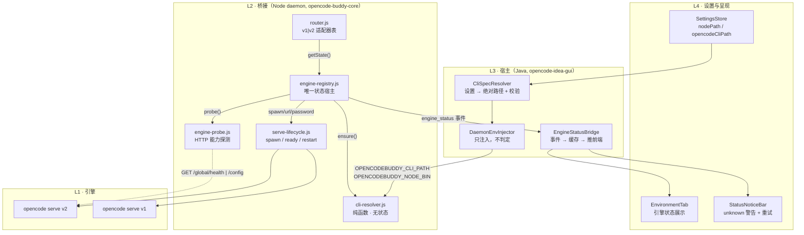

# 引擎解析（CLI 定位 + v1/v2 判定）—— 架构设计

> 本文只讲**架构**：分层、模块边界与契约、状态机形式定义、依赖规则、并发模型、扩展点、失败分类、测试 seam。
> 流程与时序、缺陷清单、落地改动表见 `docs/cli-path-and-engine-mode-architecture.md`（下称"流程文档"）。
> 覆盖仓库：`opencode-idea-gui`（Java 宿主 + webview）、`opencode-buddy-core`（Node 守护进程 / ai-bridge）。

---

## 0. 结论先行：现状的 6 个**架构级**缺口

流程文档列的 D1–D12 是**行为缺陷**；它们背后还有 6 个结构问题。只修 D 不修 A，同类事故会再犯。

| # | 缺口 | 证据 | 结构性后果 |
|---|------|------|-----------|
| **A1** | **宿主侧没有引擎状态** | `DaemonBridge.handleDaemonEvent` case `"ready"`（`DaemonBridge.java:833-839`）只读 `sdkPreloaded`，`engineMode` / `cliVersion`（`daemon.js:596-597` 确实发了）被直接丢弃 | daemon 报了什么，宿主就丢什么；设置页/状态栏**无法**展示引擎模式，用户永远看不到真实原因 |
| **A2** | **状态查询 = 隐式计算**（副作用藏在 getter 里） | `isV2()`（`serve-manager.js:166-171`）、`getDetectedCliVersion()`（`:156-161`）在未初始化时会**触发 `initEngineMode()`** | 状态在"任意第一个调用点"被计算一次，且不可控；这正是"启动即锁死"能成立的前提 |
| **A3** | **一个模块背 4 个职责** | `opencode-serve-manager.js` 同时承担：①CLI 解析 ②引擎判定 ③进程生命周期（spawn/stop/auto-restart/端口回滚）④鉴权（`_serverPassword`） | 没有任何 seam：测试只能整模块 mock；任何一处改动都可能扰动另外三处（D6/D8/D9 都是这个形状） |
| **A4** | **候选解析有 3 套独立实现** | ①`cli-path.js:326 detectCliBinAndEngineMode` ②`cli-path.js:260 resolveOpenCodeCliPath`（`findBinary()` 在未初始化时走这套）③Java `CliStatusDetector.candidatesFor`（`CliStatusDetector.java:140-173`） | 三方各说各话，"设置页显示已安装 / daemon 找不到"必然发生，且无法对账（D12 只是它的一个表征） |
| **A5** | **"进程就绪"与"引擎就绪"未分离** | `_ensureReady()`（`opencode-daemon-service.js:296-306`）只 ensure serve **进程**；`_sdkPrepared = true` 与引擎模式无关 | 进程活着但模式未知时，请求照发 → 打到错路由（本次线上故障的直接出口） |
| **A6** | **观测面缺引擎维度** | `status` 命令（`daemon.js:392-407`）只回 `serveRunning/serverUrl/sdkPreloaded`，**不含引擎模式**；`engine mode determined at boot` 只写 stderr | 出问题时没有可自检的单一事实来源，只能翻日志 grep |

**目标架构的一句话**：把"引擎模式"从一个**散落在进程生命周期模块里的可变布尔**，提升为一个**独立的状态宿主机（EngineRegistry）+ 一个纯函数解析器（CliResolver）+ 一个能力探测器（EngineProbe）**，并用 `resolve → verify → lock` 三段式把"未知"变成一等公民。

---

## 1. 架构总览



**依赖方向是单向的、并且严格分层**：`L4 → L3 → L2 → L1`。反向依赖、跨层回指、平级互相引用一律禁止（§5 给出可检查的规则清单）。

关键结构变化：

| 现状 | 目标 | 为什么 |
|------|------|--------|
| `opencode-serve-manager.js` 一个模块 4 职责（A3） | 拆成 `cli-resolver` / `engine-probe` / `engine-registry` / `serve-lifecycle` | 每层可单独替换、单独测试 |
| `_isV2` 布尔 + `_engineInitialized` 锁标 | `engine-registry` 的三态 + 证据链 | "未知"能表达（D4） |
| `isV2()` getter 隐式触发解析（A2） | `getState()` 纯读；`ensure()` 显式异步 | 计算时机可控（D1/D6） |
| 3 套候选实现（A4） | 1 套 `cli-resolver`，Java 侧只注入+展示 | 单一权威（D12） |
| 宿主丢弃引擎信息（A1） | `engine_status` 事件 + 宿主桥接 | 故障可见（D7 的 UX 出口） |

---

## 2. 模块分解与契约

每个模块给出：**职责 / 对外 API / 不变量 / 明确不做**。"明确不做"是架构边界，写进代码注释与 review checklist。

### 2.1 `cli-resolver.js`（重构自 `utils/cli-path.js`）

| 项 | 内容 |
|---|---|
| 职责 | 按 L0→L4 优先级产出**一个已验证的** CLI 绝对路径；平台差异（Windows `.cmd`、macOS login shell、WSL、PATH 补全）全部内聚于此 |
| 对外 API | `resolveCli({ kind, env }, deps)` → `Resolution`（§4.1）；保留 `resolveCliPath/probeCliVersion` 作为内部函数 |
| 不变量 | ① **纯函数**：不写全局、不改 `process.env`、不 spawn 长驻进程；② 返回 `ok:true` 时 `path` 一定通过了 `--version` 探测；③ 候选顺序确定性，同一输入同一输出 |
| 不做 | 不判引擎版本语义（`v2.0.27` 只是字符串）；不 spawn serve；不知道 engine-registry 存在 |

> 平台差异通过 `deps` 注入（`platform / exists / execProbe / home / env`），因此三平台可以**在任意一台机器上**用单测覆盖（§12）。这是把 A4/D2 从"只能靠真机验证"变成"CI 可验证"的关键。

### 2.2 `engine-probe.js`（新增）

| 项 | 内容 |
|---|---|
| 职责 | 对着**已经跑起来的**服务做能力探测，回答"这个 server 是 v1 还是 v2" |
| 对外 API | `probeEngine({ baseUrl, auth, directory, timeoutMs, fetchImpl })` → `{ engine, evidence, tries }`（§4.2） |
| 判据 | `GET /global/health`（或备选 `/api/health`、`/api/info`）→ 200 且 `content-type: application/json` ⇒ v2；否则 `GET /config` → JSON ⇒ v1；都不满足 ⇒ `unknown` |
| 不变量 | ① 有超时上限（默认 3s）与有限重试（≤2 次）；② **绝不**因为"探测失败"返回 v1（禁止隐式降级）；③ 只看能力，不看 `--version` 字符串 |
| 不做 | 不 spawn、不读环境变量、不读写状态 |

### 2.3 `engine-registry.js`（新增）—— 架构核心

| 项 | 内容 |
|---|---|
| 职责 | 引擎模式的**唯一状态宿主**：持有 state/证据/原因，编排 `resolve → spawn → probe → lock`，对外提供 `ensure()` 闸门 |
| 对外 API | `getState()` / `isV2()` / `ensure()` / `lock()` / `invalidate()` / `getStatus()` / `subscribe()` / `reset()`（§4.3） |
| 不变量 | ① **只有 `probeEngine` 成功才能进入 v1/v2**（lock 前置条件）；② 不存在 `v1 ↔ v2` 直接迁移，必须经 `pending`；③ `ensure()` 幂等 + in-flight 合并；④ 状态变更**必然**发一次 `engine_status` |
| 不做 | 不直接 `spawn`（委托 serve-lifecycle）；不实现 HTTP 路由（那是 router 的事） |

> **它是本次架构调整的落点。** A2/A5/D1/D6/D8 的共同根因是"状态挂在错误的宿主上"：挂在 serve-manager 的模块级变量里，于是只能靠"启动时算一次 + 永久锁死"来保证确定性。独立成 registry 后，确定性由**不变量**保证，而不是由"早期一次性计算"保证。

### 2.4 `serve-lifecycle.js`（瘦身自 `opencode-serve-manager.js`）

| 项 | 内容 |
|---|---|
| 职责 | 进程生命周期：端口探测/回滚、`spawn`、readiness 轮询、优雅停止、崩溃退避重启、stderr 环形缓冲、鉴权口令生成 |
| 对外 API | `start(port)` / `stop()` / `isRunning()` / `getServerUrl()` / `getServerPassword()` / `onServeExit(cb)` / `getStderrTail()` |
| 不变量 | ① **模块内不再有任何 `_isV2`**；② readiness 判据由调用方给出（`waitForReady(url, { check })`），本模块不假设模式；③ `spawn`/`kill` 是本模块的**专属副作用权限** |
| 不做 | 不判模式、不解析 CLI 路径（路径由 registry 传入 `start({ binary })`） |

### 2.5 `router.js`（从 `opencode-sdk-client.js` 收敛）

| 项 | 内容 |
|---|---|
| 职责 | 把 23 处分叉（`sdk-client.js` 中 `serveManager.isV2()` 的全部调用点）收敛成一张**适配器表** |
| 对外 API | `route(key, params)`；`ROUTES = { v1: {...}, v2: {...} }`；入口统一 `await registry.ensure()` |
| 不变量 | ① 每个导出业务函数**入口先 ensure**，拿到确定模式后才选适配器；② `unknown` 时抛 `EngineUnresolvedError`，**不发任何 HTTP 请求**；③ 不改 v1/v2 各自的请求形状（本次不动路由实现） |
| 不做 | 不猜模式、不 fallback 到另一套路由 |

**兼容期形态（重要，决定改动半径）**：保留同步 `isV2()` 作为**纯读**访问器（不再隐式触发解析），在**每个导出函数入口**插入 `await registry.ensure()`。这样：

- 23 处 `if (serveManager.isV2())` 的**形状不变**（改名 `registry.isV2()`），改动是机械替换；
- 语义从"读一个可能从未被正确计算的布尔"变成"读一个已被闸门保证的状态"；
- 无需把 23 处改成 async 分支（见 ADR-3）。

### 2.6 Java 侧三个模块

| 模块 | 现状 | 目标职责 | 不做 |
|------|------|----------|------|
| `CliSpecResolver`（新） | 逻辑内联在 `DaemonBridge.launchConfiguredDaemon`（`DaemonBridge.java:364-369`）+ `CliStatusDetector` 私有候选 | 读设置 → 解析为绝对路径 → **校验**（存在 + 可执行 + `--version` 可解析）→ 产出 `CliSpec{ opencodePath, nodePath, valid, error }` | 不维护候选目录列表（唯一权威在 `cli-resolver.js`）；不做引擎判定 |
| `DaemonEnvInjector`（`EnvironmentConfigurator` 收敛） | 只注入 `OPENCODE_BIN`，node 靠"改 PATH"（`EnvironmentConfigurator.java:56-104`） | 注入 `OPENCODEBUDDY_CLI_PATH` / `OPENCODEBUDDY_NODE_BIN` / `OPENCODEBUDDY_CONFIG_DIR`；PATH 补全**保留但降级**为兜底 | 不表达"用户指定"语义之外的任何判断 |
| `EngineStatusBridge` | 不存在（A1） | 消费 `engine_status` 事件 → 本地缓存 → 随 `updateDaemonStatus` 的 `engine` 字段送达前端 | 不推断状态，只转发 |

> `EngineStatusBridge` 落地时**未单独建类**：缓存放在 `DaemonBridge`（`getEngineStatus()`），送达复用已有的 `window.updateDaemonStatus` 通道（`DaemonStatusHandler`）。见 §11.1。

`CliStatusDetector` 降级为**展示层**：候选规则改为与 `cli-resolver.js` 对齐（或直接调用其 Node CLI 入口）；它的 `probe()` 里"文件存在即可执行也算已安装，版本 `unknown`"（`CliStatusDetector.java:219-224`）必须与 resolver 的严格语义分开——**设置页可以宽松展示，daemon 必须严格判定**，两者结论不一致时必须显式区分"检测到但不可用"。

---

## 3. 状态机形式定义

### 3.1 状态

```ts
type EngineState = 'pending' | 'v1' | 'v2' | 'unknown';
```

| 状态 | 含义 | 是否允许发业务请求 |
|------|------|------------------|
| `pending` | 尚未确定（进程刚起 / serve 重启后 / 用户点了重新检测） | 否（请求在 `ensure()` 上排队，有上限等待） |
| `v1` / `v2` | **已验证并锁定**，证据为一次成功的 probe | 是 |
| `unknown` | 解析或探测失败；带 `reason` 与 `blocking` | 否 |

> `unknown` 与 `pending` 的区别是**语义**而非生命周期：`pending` 表示"还有机会自动确定"，`unknown` 表示"这一轮确定失败了"。二者都不是 `v1`。

### 3.2 迁移表

| 当前 | 事件 | 条件 | 目标 | 副作用 |
|------|------|------|------|--------|
| `pending` | `SPEC_INVALID` | 宿主注入的用户设置校验失败 | `unknown` | `reason.kind=settings-invalid`, `blocking=true`；**不 spawn**；上报 |
| `pending` | `RESOLVE_FAIL` | L0–L4 全部候选验证失败 | `unknown` | `reason.kind=cli-not-found`, `blocking=true`；上报 |
| `pending` | `RESOLVE_OK` | 得到 `{path, version, source}` | `pending` | 记录 `cli.*`，继续 spawn；**不以 version 判模式** |
| `pending` | `SERVE_READY` | 进程就绪 | `pending` | 触发 `probeEngine()` |
| `pending` | `PROBE_V2` | `/global/health` 200 + JSON（或备选 `/api/health`、`/api/info`） | `v2` | `lock()`，`evidence` 落盘；上报 |
| `pending` | `PROBE_V1` | `/config` 返回 JSON | `v1` | 同上 |
| `pending` | `PROBE_UNKNOWN` | 两者均不通 | `unknown` | `blocking=false`，进入 auto-restart 预算内重试；预算耗尽 → `blocking=true` |
| `v1`/`v2` | `SERVE_EXIT` | 进程退出（崩溃） | `pending` | `invalidate('serve-exit')`；保留 `cli.*` 缓存，模式**必须重探** |
| `v1`/`v2` | `EVIDENCE_CONTRADICTS` | 运行期观测到与锁定不符（如 `/global/health` 突然 404） | `pending` | WARN + 重探，禁止直接翻转 |
| `unknown` | `RETRY` | 用户点重试 / 下一个请求 | `pending` | 重跑 resolve+probe（`blocking=true` 时需用户显式触发） |
| 任意 | `SETTINGS_CHANGED` | 用户在设置页保存 | 进程终止 | **由宿主重启 daemon**；进程边界 = 失效边界（ADR-5） |

### 3.3 不变量（写进代码断言）

- **INV-1**：`state ∈ {v1, v2} ⇒ ∃ evidence ∈ {/global/health 200, /config JSON}`。版本字符串永远**不是**充分证据。防 SPA HTML 回退：必须校验 `Content-Type: application/json`。
- **INV-2**：`v1 → v2` 与 `v2 → v1` 无直接迁移，必经 `pending`。任何"直接翻转"都是 bug。
- **INV-3**：`state === 'unknown' && blocking` ⇒ router 必须抛错，且错误消息可读（含 `reason.kind`），不允许发请求。
- **INV-4**：`lock()` 前置条件为"本次 `probeEngine` 返回 v1|v2"；违反即抛断言（生产环境降级为 WARN + 不锁定）。
- **INV-5**：状态每次变更 → 恰好一次 `engine_status` 上报（去重：state+evidence+reason 未变则不上报）。
- **INV-6**：`ensure()` 在 `state ∈ {v1,v2}` 时是 **O(1) 同步返回**，不得重复探测。

---

## 4. 核心接口（IDL）

### 4.1 `resolveCli`

```js
/**
 * @param {{ kind: 'opencode'|'node', env: NodeJS.ProcessEnv }} spec
 * @param {{
 *   platform?: NodeJS.Platform,           // 'win32'|'darwin'|'linux'
 *   env?: NodeJS.ProcessEnv,              // 覆盖 spec.env（测试用）
 *   exists?: (p:string)=>boolean,         // io seam
 *   execProbe?: (cmd:string[], opts:object)=>{code:number,stdout:string,stderr:string}, // io seam
 *   home?: string
 * }} [deps]
 * @returns {Resolution}
 */
```

```ts
type Resolution =
  | { ok: true;  kind: 'opencode'|'node'; path: string; version: string;
      source: 'settings'|'env'|'known-dir'|'path'|'bare';
      spawn: { needsShell: boolean; argv0: string } }
  | { ok: false; kind: 'opencode'|'node'; reason: ResolveReason; tried: string[] };

type ResolveReason =
  | { kind:'settings-invalid'; path:string; detail:string }   // L0 校验失败 → 阻断
  | { kind:'cli-not-found';     tried:string[] }              // 全部候选失败
  | { kind:'probe-failed';      path:string; detail:string }; // 找到文件但 --version 不通
```

**L0 与 L1 用不同变量名区分用户意图**（ADR-4）：

| 优先级 | opencode 变量 | node 变量 | 语义 |
|--------|--------------|-----------|------|
| **L0 用户设置**（宿主注入） | `OPENCODEBUDDY_CLI_PATH` | `OPENCODEBUDDY_NODE_BIN` | **权威**：校验失败 → `settings-invalid` + `blocking`，**不回退** |
| L1 显式环境变量（用户 shell） | `OPENCODE_BIN` / `OPENCODE_PATH` / `OPENCODE_CLI_PATH` | `NODE_BIN` | 尽力：失败继续下一级 |
| L2 已知安装位置 | 平台矩阵（流程文档 §6） | 平台矩阵 | 尽力 |
| L3 PATH | `where` / `which` | 同 | 尽力 |
| L4 裸名 | `opencode` | `node` | 尽力；仍失败 → `cli-not-found` |

### 4.2 `probeEngine`

```js
/**
 * @param {{ baseUrl:string, auth?:{password:string}, directory?:string,
 *           timeoutMs?:number, fetchImpl?:typeof fetch, retries?:number }} opts
 * @returns {Promise<{ engine:'v1'|'v2'|'unknown'; tries:number; evidence:Evidence }>}
 */
type Evidence = { probePath:string|null; status:number|null; contentType:string|null; observedAt:number };
```

**可扩展性设计**：不把状态写成字面量，而是让探测器返回服务端**自报的 API 版本**，再用映射表决定模式：

```js
// GET /global/health → { healthy: true, version: '1.19.1', apiVersion?: 2 }
const ENGINE_BY_API_VERSION = { 1:'v1', 2:'v2' /*, 3:'v3'*/ };
```

这样未来加 v3 时，探测器与状态机结构不变，只加一条映射（§9）。若探测端点不提供显式 `apiVersion`，回退到"路径能力探测"（`/global/health` 存在且为 JSON ⇒ v2）。同时按顺序探测 `['/global/health', '/api/health', '/api/info']` 保证向下兼容。

### 4.3 `engine-registry`

```js
export function getState(): 'pending'|'v1'|'v2'|'unknown';
export function isV2(): boolean;                              // 纯读：state === 'v2'
export function ensure(): Promise<'v1'|'v2'>;                 // 幂等闸门；unknown → 抛 EngineUnresolvedError
export function getStatus(): EngineStatus;                     // 供 status 命令 / 上报 / 测试
export function subscribe(fn: (s: EngineStatus) => void): () => void;
export function invalidate(reason: string): void;
export function configure({ resolve, probe, serve, env }): void; // 依赖注入（测试 seam）
export function reset(): void;                                 // 测试专用
```

```ts
type EngineStatus = {
  state: 'pending'|'v1'|'v2'|'unknown';
  cli: { path: string|null; version: string|null;
         source: 'settings'|'env'|'known-dir'|'path'|'bare'|null };
  evidence: Evidence | null;
  reason: { kind: 'none'|'settings-invalid'|'cli-not-found'|'probe-timeout'
                 |'probe-mismatch'|'spawn-failed'|'serve-exit';
            message: string; blocking: boolean };
  updatedAt: number;
};
```

### 4.4 跨进程契约

**daemon → 宿主**（新事件，`sendDaemonEvent` 复用，`daemon.js:200`）:

```json
{ "type": "daemon", "event": "engine_status",
  "state": "v2", "cliPath": "...", "cliVersion": "opencode v2.0.27",
  "cliSource": "settings", "probePath": "/api/info", "httpStatus": 200,
  "reasonKind": "none", "reasonMessage": "", "blocking": false, "ts": 1760000000000 }
```

`ready` 事件的 `engineMode` 字段语义修正：**只在已锁定时填 `'v1'|'v2'`，否则填 `'pending'`**（当前无条件填 `'v1'|'v2'`，`daemon.js:596`，是在撒谎）。

**宿主 → 前端**：`window.updateEngineStatus(payload)`，payload 与上表同构（camelCase 直通）。
`status` 命令响应（`daemon.js:393`）增加 `engine: EngineStatus`，作为**唯一自检入口**（A6）。

---

## 5. 架构规则（可检查）

**依赖方向**

| 规则 | 说明 |
|------|------|
| R1 | `L4 → L3 → L2 → L1` 单向；禁止反向 import |
| R2 | `cli-resolver` **不得** import registry / serve-lifecycle / router（纯函数层） |
| R3 | `serve-lifecycle` **不得** import registry（不判模式）；模式相关判据由调用方以参数传入 |
| R4 | `router` 只依赖 registry 的 `ensure/getState`；**不得**直接 import `engine-probe` |
| R5 | registry 是 `engine-probe` 的**唯一**调用者 |
| R6 | 后端（Node）**不得**依赖宿主实现；宿主不得实现候选扫描规则（A4） |

**副作用边界**

| 权限 | 专属模块 |
|------|---------|
| `spawn` / `kill` / 端口绑定 | `serve-lifecycle` |
| 写 `process.env` | 仅 daemon 启动处（不再由 `enrichPathWithBinDirs` 在探测路径里就地改传入对象） |
| HTTP 探测 | `engine-probe` |
| 变更 `state` | `engine-registry`（且必须走迁移表） |

**禁止清单**（review checklist）

- ❌ `isV2()` 内部触发解析（A2）
- ❌ `if (!ver) continue` 后返回 `isV2:false`（D4）
- ❌ `execFileSync(bin, ['--version'])` 不带 `shell`（D2）
- ❌ 候选列表在 Java 与 Node 各写一份（D12/A4）
- ❌ `waitForReady` 的"任何响应即就绪"分支（D7）
- ❌ 模块级 `_engineInitialized` 这类"一次性锁标"（D1/D6）

---

## 6. 并发与生命周期模型

| 场景 | 设计 |
|------|------|
| 并发首次请求 | `ensure()` 用单个 in-flight promise 合并；`state ∈ {v1,v2}` 时同步返回（INV-6） |
| 首个请求早于 serve 就绪 | `ensure()` 内部 `await serve.start()` → probe → lock，请求在闸门排队（这是 A5 的修复：**进程就绪 ≠ 引擎就绪**） |
| serve 崩溃 | `onServeExit` → `registry.invalidate('serve-exit')` → `pending`；下个请求经 `ensure()` 重跑；auto-restart 预算沿用现有退避（`serve-manager.js:532-550`） |
| 设置变更 | 宿主 `stop()` + `start()` daemon（进程边界）；不做热重载（ADR-5） |
| 状态读取 | `getState()` / `isV2()` / `getStatus()` 全部纯读，无副作用 |
| 上报去重 | 状态指纹（state+evidence+reason）变化才发事件（INV-5） |
| 状态宿主范围 | **一个 daemon 进程一个 registry**；不跨进程共享、不落盘（进程重启即重算，与 ADR-5 一致） |

**幂等性表**

| 操作 | 幂等 | 说明 |
|------|------|------|
| `resolveCli` | 是 | 纯函数 |
| `probeEngine` | 是 | 只读 HTTP |
| `ensure()` | 是 | in-flight 合并 + 锁定短路 |
| `lock()` | 否（前置条件约束） | 违反 INV-4 抛断言 |
| `serve.start()` | 是 | 已有实现即复用（`serve-manager.js:313-325`） |

---

## 7. 失败分类学与降级矩阵

| 类别 | `reason.kind` | 触发 | blocking | 是否自动重试 | UI 出口 |
|------|---------------|------|----------|-------------|---------|
| 设置路径无效 | `settings-invalid` | L0 校验失败 | ✅ | ❌ | 错误面板 + "改用自动检测" |
| 找不到 CLI | `cli-not-found` | L0–L4 全败 | ✅ | ❌ | 安装指引（按平台） |
| 探测超时 | `probe-timeout` | probe > 3s | ❌ | ✅（退避） | 状态栏"正在重试" |
| 探测无匹配 | `probe-mismatch` | v1/v2 探针均不通 | ❌→✅（预算耗尽） | ✅ | 状态栏 + 查看日志 |
| spawn 失败 | `spawn-failed` | `ENOENT` / 早退 | ✅ | ✅（预算内） | 错误面板 + stderr 尾部 |
| 服务崩溃 | `serve-exit` | 稳态退出 | ❌ | ✅ | 状态栏（沿用现有） |

**核心原则**：`blocking=true` 的错误**必须**阻断业务请求并可见；**任何**类别都**不允许**降级成"用 v1 试试"。

---

## 8. 可观测性设计

| 手段 | 内容 |
|------|------|
| 日志级别 | 解析失败 / 探测失败 → **WARN**（当前是 INFO，`serve-manager.js:145`）；`lock` 成功 → INFO 且**必须带证据**（`probePath` + `httpStatus` + `source`） |
| 结构化事件 | `engine_status`（§4.4），含 `probePath/httpStatus`，让"为什么判成 v2"可回溯 |
| 自检入口 | `status` 命令返回 `engine: EngineStatus`（A6） |
| 环境诊断块 | 现有 `Runtime Environment Diagnostic`（`serve-manager.js:392-403`）改为打印 `EngineStatus` 全量（含 `reason`） |
| 前端 | `EnvironmentTab` 展示 `path / version / source / state / evidence`；`unknown` 时 `StatusNoticeBar` 出警告条 + 重试按钮 |
| 单测断言点 | `getStatus()` 是唯一断言入口（避免测试去摸私有变量） |

---

## 9. 扩展点

| 扩展 | 做法 | 需要改的地方 |
|------|------|-------------|
| **新增引擎 v3** | `probeEngine` 已返回 `apiVersion` → 在 `ENGINE_BY_API_VERSION` 加一行；`ROUTES.v3` 加适配器 | `engine-probe`（1 行）+ `router`（1 个适配器），**状态机不变** |
| **新增 CLI 工具**（grok/kimi/pi 等） | 表驱动 `CliToolDescriptor{ id, binaryName, envKeys, knownDirs, platformExt }` | 只加一个描述符；`CliStatusDetector` 与 resolver 共用同一张表（消除 A4 的第三套） |
| **新增平台** | 实现 `PlatformAdapter{ whichCommand, spawnablePriority, needsShell(path), homeCandidates(), loginShellFallback }` | 只加一个适配器；resolver 主流程不动 |
| **WSL / 容器** | 作为"宿主平台 = win32 但 CLI 在 Linux"的组合，走 `PlatformAdapter` 的组合态 | 适配器内处理（流程文档 §6 已列 URL/`WSLENV` 细节） |
| **鉴权方式变更** | 口令由 `serve-lifecycle` 生成、经 `getServerPassword()` 暴露 | 只需改这一处（现状 D9 是模块加载期读 env，正因职责混在一起） |

---

## 10. 架构决策记录（ADR）

| # | 决策 | 备选 | 理由 |
|---|------|------|------|
| **ADR-1** | 引擎状态独立成 `engine-registry` 模块 | 继续放在 `serve-manager` 内 | 放在生命周期模块里，"确定性"只能靠"启动时算一次 + 锁死"实现（D1/D6 的形状）；独立后靠不变量保证 |
| **ADR-2** | 用 HTTP 能力探测判模式 | 用 `--version` 字符串 `!startsWith('1.')` | 版本号是间接证据且依赖探测能成功（D2）；能力探测直接问服务端"你是谁"，且天然可扩展（§9） |
| **ADR-3** | 保留同步 `isV2()`（纯读）+ 每个导出函数入口 `await ensure()` | 把 23 处调用改成 async 分支 | 改动半径从"重写 23 个函数体"降到"机械替换 + 入口插一行"；且 `isV2()` 在内部纯读是**可证明安全**的（INV-6 保证 ensure 后必为确定值） |
| **ADR-4** | 用户设置走独立变量名 `OPENCODEBUDDY_CLI_PATH` / `OPENCODEBUDDY_NODE_BIN` | 复用 `OPENCODE_BIN` | 复用会丢失"来源"语义（A1/D10）；独立命名后 resolver 能标注 `source:'settings'` 并实施"阻断式失败"，也不与用户 shell 同名变量混淆 |
| **ADR-5** | 设置变更走 **daemon 重启**，不热重载 | 热重载 env/状态 | env 在子进程创建后不可变；热重载需要引入"状态可变更"的复杂度，而重启的代价是 1 次进程启动 + probe（<1s），不值为之增加状态维度 |
| **ADR-6** | 解析权威在 Node（`cli-resolver.js`） | Java 侧也实现完整候选扫描 | 实际执行 CLI 的是 daemon；宿主侧的候选规则无法与真实 spawn 行为对齐（A4/D12）。宿主只做"注入 + 展示" |
| **ADR-7** | `pending` / `unknown` 都是显式状态，禁止布尔化 | 保留 `isV2: boolean` | 布尔无法表达"还没确定"（D4 的全部根因） |

---

## 11. 现状 → 目标映射

| 现状位置 | 目标 | 动作 |
|----------|------|------|
| `cli-path.js:260 resolveOpenCodeCliPath` | `cli-resolver.resolveCli({kind:'opencode'})` | 合并；L0/L1 变量名拆分 |
| `cli-path.js:326 detectCliBinAndEngineMode` | **删除** | 其返回值拆给 registry（`cli.*`）与 probe（`state`） |
| `cli-path.js:300 probeCliVersion` | `cli-resolver` 内部 `execProbe` 注入 | Windows `.cmd` 走 `shell:true`（D2） |
| `serve-manager.js:131 initEngineMode` | **删除** | 由 `registry.ensure()` 取代 |
| `serve-manager.js:156-171 getters` | `registry.getState()/getStatus()` | 纯读，无副作用 |
| `serve-manager.js:313-511 start/doStart` | `serve-lifecycle.start({binary, port, waitFor})` | 去掉模式判定；readiness 判据由参数传入 |
| `serve-manager.js:246-290 waitForReady` | `serve-lifecycle` 内 `waitForReady(url, {check})` | 判据外部化（D7） |
| `sdk-client.js` 23 处 `isV2()` | `router` 适配器表 | 机械替换 + 入口 ensure |
| `daemon.js:584,596` | registry 初始化 + `engine_status` 事件 | `ready.engineMode` 改 `'pending'|'v1'|'v2'` |
| `daemon.js:393 status` | + `engine: EngineStatus` | 自检入口 |
| `daemon-service.js:296 _ensureReady` | 增加 `await registry.ensure()` | 修 A5 |
| Java `DaemonBridge.java:364-369` | `CliSpecResolver` + `DaemonEnvInjector` | 注入独立变量名 |
| Java `CliStatusDetector.java:140-173` | 表驱动 + 与 resolver 对齐 | 消 A4/D12 |
| Java `handleDaemonEvent`（无 engine 分支） | `EngineStatusBridge` | 修 A1 |
| `engine-mode.test.js` | 重写为状态机 + resolver 测试 | 见 §12 |
| `cli-path.test.js` | 保留并扩展（三平台矩阵） | 见 §12 |

### 11.1 落地状态（2026-10-16）

**已落地（`opencode-buddy-core`）**

| 目标 | 实际文件 | 备注 |
|------|----------|------|
| `cli-resolver.resolveCli` | `utils/cli-path.js` | 保留原文件名，新增 `CLI_DESCRIPTORS` / `buildCandidates` / `resolveCli` / `describeResolveFailure`；`detectCliBinAndEngineMode` **已删除** |
| `engine-probe` | `utils/engine-probe.js`（新） | `ENGINE_BY_API_VERSION`、`probeEngine`、`describeProbeFailure` |
| `engine-registry` | `services/opencode/engine-registry.js`（新） | 状态机宿主，`ensure()` 为**探测优先**（见下） |
| `serve-lifecycle` | `opencode-serve-manager.js` | 就地瘦身（未拆文件）；`initEngineMode`/`isV2`/`getDetectedCliVersion` 已删 |
| `router` | 未拆 | `sdk-client.js` 仅做 `serveManager.isV2()` → `registry.isV2()` 机械替换（24 处）；入口 `ensure()` 已加 |
| `daemon.js` 接入 | 已改 | `engine_status` 事件、`status.engine`、`ready.engineMode='pending'`、dispatch 前 `await ensure()` |
| 测试 | `cli-resolver.test.js`（11）、`engine-probe.test.js`（10）、`engine-registry.test.js`（16）、`serve-manager.test.js`（7，重写） | `engine-mode.test.js` 已删；core 全量 **142 通过 / 0 失败** |

**已落地（`opencode-idea-gui` 宿主）**

| 目标 | 实际文件 | 备注 |
|------|----------|------|
| `CliSpecResolver` | `bridge/CliSpecResolver.java`（新） | 读设置 → 展开 `~` / `%VAR%` / `$VAR` / 相对路径 → 产出 `CliSpec`；**不做存在性检查、不做 `--version` 探测**（见 ADR-6 补充） |
| `DaemonEnvInjector` | `bridge/EnvironmentConfigurator.java` | 收敛进既有的 `updateProcessEnvironment`——它是 daemon.js 与一次性 channel-manager.js **唯一共同的**注入点，天然不会漂移；同时补进 `WSLENV` 转发 |
| `EngineStatusBridge` | `provider/common/DaemonBridge.java` + `handler/DaemonStatusHandler.java` | 未单独建类：`DaemonBridge` 缓存 `engine_status` 快照（`getEngineStatus()`），`DaemonStatusHandler` 把它并入既有 `window.updateDaemonStatus` 载荷的 `engine` 字段 |
| 宿主单测 | `bridge/CliSpecResolverTest.java`（20） | 与 core 同样的注入式 seam（供应商 + 显式 home） |

**尚未落地（明确记录，避免文档与代码不一致）**

1. `router.js` 未从 `sdk-client.js` 拆出：`isV2()` 的**形状**保持 23 处分支不变（ADR-3），拆文件是纯整理，收益低于回归风险。
2. `CliStatusDetector` 仍是旧的候选规则，尚未与 `cli-resolver.js` 对齐（A4/D12 未闭环）。设置页展示与 daemon 判定仍可能出现"检测到但不可用"的措辞差异。
3. webview 侧没有 `window.updateEngineStatus`：`engine` 字段已随 `updateDaemonStatus` 到达前端，但 UI 尚未渲染（前端目前会忽略未知字段，因此无副作用）。补 UI 时**不需要**动宿主。
4. `engine_status` 事件目前只在状态**变化**时推送；前端若在事件之后才 ready，需要靠 `check_daemon_status` 重新取一次（`pushStatus` 每次都带 `engine`，因此已覆盖）。

### 11.2 两处与设计稿的偏离及理由

- **`ensure()` 采用"探测优先"而非"先解析 CLI 再探测"。** 设计稿写的是先 `resolveCli` 再 `probeEngine`。实现改为先探测：一次性进程 `channel-manager.js` 并不拥有 serve 子进程，一次 HTTP 往返（毫秒级）比在 Windows 上 fork 一个 `--version` 子进程（约 100ms）更便宜，且"探测失败再退回解析"的顺序让"服务已在跑"这一最常见情形不必触碰文件系统。
- **宿主不做存在性校验。** 设计稿的阶段 0 写了"存在 + 可执行 + `--version` 可解析"。实现只做路径展开，理由有两条：(1) daemon 可能与 IDE 宿主处于**不同的文件系统命名空间**（WSL 下 node 经 `wsl` 启动），宿主侧的 `Files.exists` 会把合法路径判为非法；而 L0 校验失败是**阻断式**的，这会直接打死一个本来可用的环境；(2) `--version` 探测要在 Java 里再实现一遍 Windows `.cmd` 需走 shell 的转义逻辑，且版本号本身只是展示用（ADR-2）。唯一权威留给"在路径真正被使用的地方运行"的 Node resolver。

---

## 12. 测试架构（seam 设计）

架构的目标之一是"**不改代码就能在 CI 上验证三平台**"。为此三处必须可注入：

| seam | 注入内容 | 可覆盖的用例 |
|------|---------|-------------|
| `resolveCli(spec, deps)` | `platform` / `exists` / `execProbe` / `home` | Windows `.exe/.cmd/.bat` 优先级、`.cmd` 需 shell、macOS login-shell 兜底、Linux PATH 补全、WSL 路径、L0 校验失败阻断 |
| `probeEngine({fetchImpl})` | 伪 HTTP 响应 | HTML 兜底页 → `unknown`（**不得**判 v2）、401 → 重试、超时、`apiVersion` 映射 |
| `registry.configure({resolve, probe, serve})` | 伪三者 | `pending→v2` 全链路、probe 失败 → `unknown` 且 `blocking` 语义、`serve-exit → pending` 重探、`ensure()` 幂等/合并、`lock()` 前置条件断言 |

补充：

- **契约测试**：`getStatus()` 的字段名/类型与 §4.4 事件 schema、前端 payload 三方一致性（同一份 fixture 三处断言）。
- **一致性测试**：`CliStatusDetector` 与 `resolveCli` 对同一 fixture 的候选顺序必须一致（消 A4 的回归护栏）。
- **Java 侧**：`CliSpecResolver` 校验分支（不存在 / 不可执行 / `--version` 输出不可解析）；`DaemonEnvInjector` 的变量名与覆盖顺序。
- **平台矩阵**：CI 增加 `windows-latest / macos-latest / ubuntu-latest` 跑 `resolveCli` 单测（现有 CI 只有 Node 版本矩阵）。
- **端到端回归**：复现本次故障（Windows + npm 全局 `.exe` + v2 服务）→ 必须 `state=v2`，且 `getStatus().evidence.probePath === '/api/info'`。

---

## 13. 与流程文档的关系

- **本文**（架构）：分层、模块契约、状态机、依赖规则、扩展点、ADR、测试 seam。
- **流程文档**（`cli-path-and-engine-mode-architecture.md`）：真实时序、D1–D12 缺陷清单与行号、L0–L4 决策表、跨平台候选矩阵、文件级落地清单、落地顺序。

两者对应关系：流程文档的 **§3 目标架构 = 本文的摘要**；本文的 **§11 映射表 ≈ 流程文档 §8 落地清单的架构视角**。实施时以本文的模块边界与不变量为准，以流程文档的行号定位改动点。
